# MORPHRIG - the Operative

One original cyberpunk character, produced end to end: procedural modelling, UVs and textures, skinning, an
animator control rig with a separate export skeleton, a facial rig with a lip-synchronised spoken performance,
96 authored animation entries, and an Unreal Engine 5 showcase packaged as a Linux client.

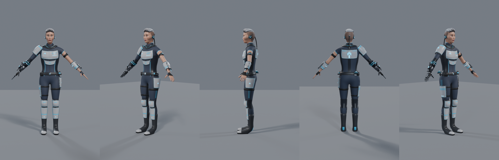
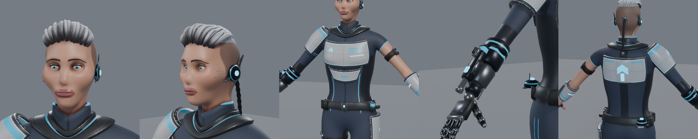

Everything that defines the character (geometry, weights, shape keys, rig, textures, animation) is generated by
the Python modules in `source/generators` - **procedural source, no interactive edits, no third-party character
content**. The only third-party input is the speech-synthesis voice used for the spoken line
(`docs/THIRD_PARTY_ASSETS.csv`).

## 1. Quick start

```sh
# run the packaged showcase (no Unreal Editor needed); F1 = help, F2 = panel, F11 = deterministic sequence
tools/run_showcase.sh
MORPHRIG_OFFSCREEN=1 tools/run_showcase.sh -MorphSequence -MorphQuit      # headless run with a state/event trace

# open the editable asset (Blender 5.1); sidebar tab "MorphRig" = rig UI
blender source/Operative.blend

# rebuild everything from the generators, then re-import / package / verify / capture in Unreal
blender -b --factory-startup -P tools/export_and_bake.py
tools/ue_full_cycle.sh
```

`tools/run_showcase.sh` starts `build/Linux/MorphRig.sh` (through the runtime wrapper named in
`../environment.json` when that file exists - the NixOS reference host needs it; on an ordinary Linux host the
client starts directly and needs no engine installation). Details: `docs/build_and_import_instructions.md`.

## 2. Where everything is

| Deliverable | Location |
|---|---|
| Editable Blender asset (mesh LOD0-2, control rig, export skeleton, 96 source + 96 baked actions, materials, rig UI) | `source/Operative.blend` |
| Textures (source = export; PNG) | `source/textures/`, `export/textures/` (+ `texture_manifest.json`) |
| Spoken line: audio, transcript, time alignment | `source/audio/dialogue.wav`, `dialogue.txt`, `dialogue_alignment.json` |
| Generators (procedural source of everything) | `source/generators/mr/*.py`, `source/generators/dialogue_audio.py` |
| Skeletal mesh FBX, LODs | `export/Operative.fbx`, `export/Operative_LOD1.fbx`, `export/Operative_LOD2.fbx` |
| Animation FBX, one file per clip, take name = clip id | `export/animations/<id>.fbx` (96) |
| Prop static meshes (beacon, power cell) | `export/props/SM_Beacon.fbx`, `SM_PowerCell.fbx` |
| Unreal project (C++ module `MorphRig`, config, map, imported content) | `unreal/` (`Binaries`, `Intermediate`, `Saved`, `DerivedDataCache` are generated and can be deleted; `tools/build_linux.sh` recreates them) |
| Packaged Linux x86-64 client | `build/Linux/MorphRig.sh` (start with `tools/run_showcase.sh`) |
| Rig usage guide | `docs/rig_usage.md` |
| Skeleton, axes, units, sockets | `docs/skeleton_and_sockets.json` |
| Animation manifest (96 entries) | `docs/animation_manifest.json` |
| State / layer / interrupt / event contract | `docs/animation_state_contract.md` |
| Triangle counts, slots, texture memory, bone count | `docs/material_and_lod_report.json` |
| Face controls, visemes, presets (with Unreal conversions) | `docs/face_controls.json` |
| Third-party manifest | `docs/THIRD_PARTY_ASSETS.csv` |
| Build and import instructions (Blender + Unreal) | `docs/build_and_import_instructions.md` |
| Known issues | `docs/known_issues.md` |
| Showcase controls and commands (full reference) | `docs/showcase_controls.md` |
| Unreal implementation notes | `docs/unreal_implementation_notes.md` |
| Verification traces and reports, benchmark logs | `docs/verification/`, `docs/benchmark/` |
| Inspection renders from the .blend | `docs/images/` (regenerate with `tools/render_evidence.py`) |
| Build / export / automation tools | `tools/export_and_bake.py` (Blender build, bake, export), `tools/build_linux.sh` (editor module, import, package), `tools/ue_import.sh` + `tools/unreal_import.py` (import only), `tools/ue_full_cycle.sh` (build, verify, bench, capture), `tools/run_showcase.sh`, `tools/run_benchmark.sh`, `tools/capture_presentation.sh`, `tools/verify_trace.py`, `tools/render_evidence.py`, `tools/scripts/*.txt` (automation scripts), `tools/ue_env.sh` (shared environment) |
| Presentation videos (captured from the packaged client) | `presentation/turntable.mp4`, `motion_showcase.mp4`, `face_performance.mp4` |

## 3. The character

An adult, androgynous-to-female-presenting field operative: silver slicked-back undercut over shaved sides, a
dark technical bodysuit with ribbed flex panels, and a limited set of white ceramic plates with graphite trim
(gorget, two-part cuirass, back plate with spine unit, right pauldron, left bracer, belt, tasset, thigh plate,
knee and shin guards, boots). The **right forearm and hand are cybernetic** (shells, pistons, hex wrist collar,
five articulated mechanical fingers); the left arm is bare skin with a fingerless glove and a barcode tattoo, so
shoulder, elbow, wrist and finger deformation stay visible.

* Wrist **emitter** on the cybernetic forearm (socket `emitter_muzzle`), fed by a removable **power cell**
  (`prop_cell`; a spare `prop_cell_spare` and an empty second cradle sit on the belt - the reload swaps them).
* Retractable **forearm blade** on the left bracer (`blade_l`, sockets `blade_base` / `blade_tip`).
* Deployable **beacon** docked at the back of the belt (`prop_beacon`).
* Secondary motion: the ribbed **data cable** from the occipital port (4 bones, simulated).
* Ear comm units, a circuit inlay on the left temple, augmented irises.

**Team variants** (same mesh, rig and textures; `T_*_Mask` channels + two parameters):
A = cyan, chevron icon, solid trim line; B = amber, ring icon, dashed trim line. In the showcase the variant
additionally switches a solid / dashed silhouette outline and ground ring, so the teams differ by shape and not
only by colour. 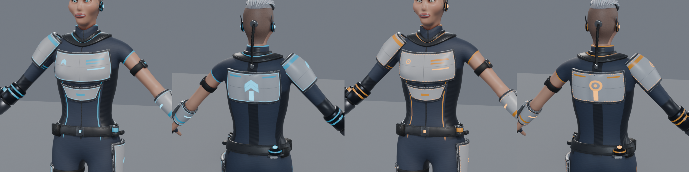 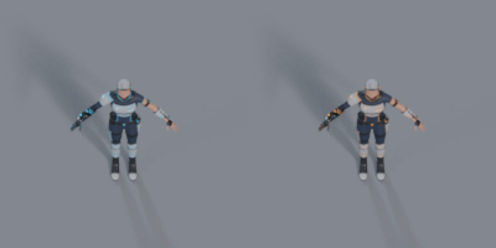

### Numbers (from `docs/material_and_lod_report.json`)

| | LOD0 | LOD1 | LOD2 |
|---|---|---|---|
| Triangles (limit) | 38,178 (80,000) | 20,249 (40,000) | 12,700 (20,000) |
| Vertices | 19,969 | 10,897 | 6,909 |
| Max bone influences per vertex | 7 | 7 | 8 |
| Morph targets | 32 | 32 | 32 |

* 6 material slots: `M_Skin`, `M_EyesMouth`, `M_Hair`, `M_Suit`, `M_Armor`, `M_Cyber` (limit 8, props included).
* 22 textures, largest 4096 (skin base colour), the rest 2048 / 1024; estimated GPU memory with block compression
  and mips 81 MiB. Base colour + normal + ORM per slot, team/emissive mask where used.
* Deformation skeleton: **84 bones**, single root `root`. Control rig: 191 bones.
* Height 1.80 m (180.8 cm to the top of the hair crest, 178.7 cm to the top of the skull). Blender: metres, +Z up, facing -Y, left = +X, origin on the
  floor between the feet. Unreal: centimetres, imported at scale 1.0, component space = Blender (x, -y, z) x 100.
* LOD1/LOD2 keep the head skin topology (all 32 morph targets work on every LOD); everything else is decimated
  with preserved UVs and weights. 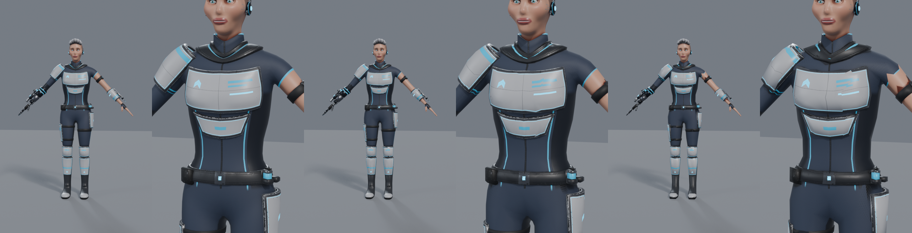
* Mesh hygiene checked by the build on every LOD: no vertex without a face, no zero-area face, no edge shared by
  more than two faces, consistent winding, every vertex fully weighted; one UV set without overlapping islands
  (`docs/images/uv_layouts.png`).

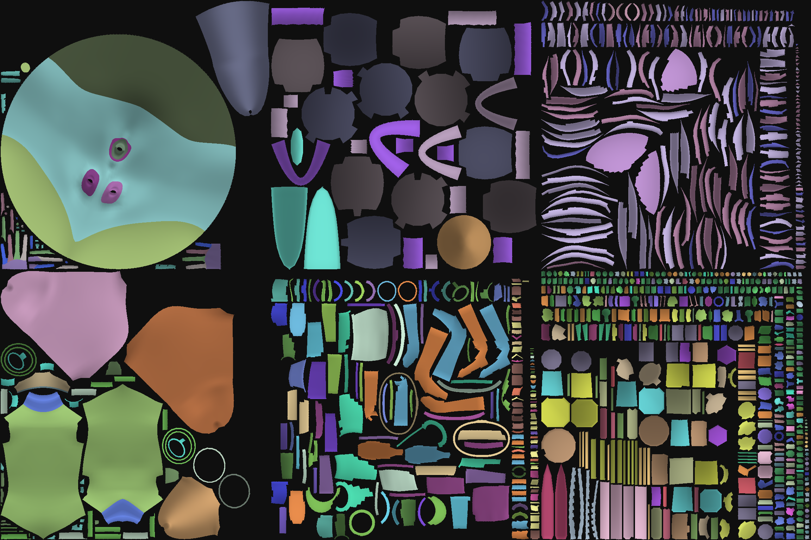

## 4. Rig, face and deformation

`docs/rig_usage.md` is the guide. In short: `RIG_Operative` (controls: IK/FK arms and legs with exact snapping,
poles, foot roll / bank / heel and toe pivots / toe bend, finger curl / spread / fist + individual phalanges,
torso, look-at, props with hand-hold switches, cable, global scale, pose reset) drives `SKEL_Operative` (export).
Twist and half-rotation helper bones keep volume at shoulders, elbows, wrists, hips and knees; their rules are
listed in `skeleton_and_sockets.json` and recomputed at runtime in Unreal.

Deformation test poses (`DEMO_*` actions): 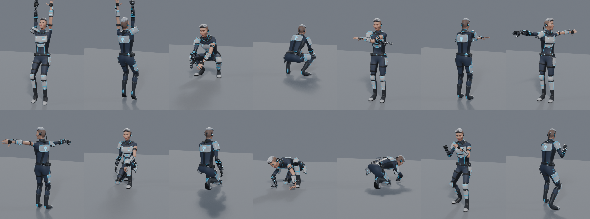

Face: 32 shape keys + jaw / eyelid / eye / tongue bones behind 42 controls, 13 visemes and 6 presets (joy, anger,
concern, surprise, pain, focus), left and right independent, eyelids following the eyeballs.
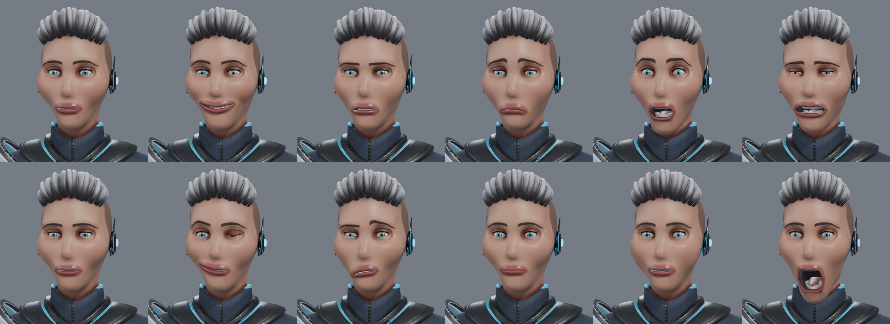 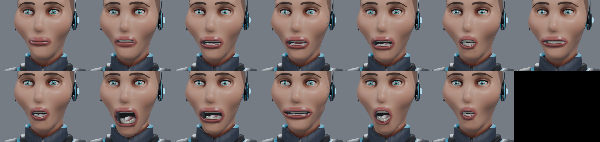 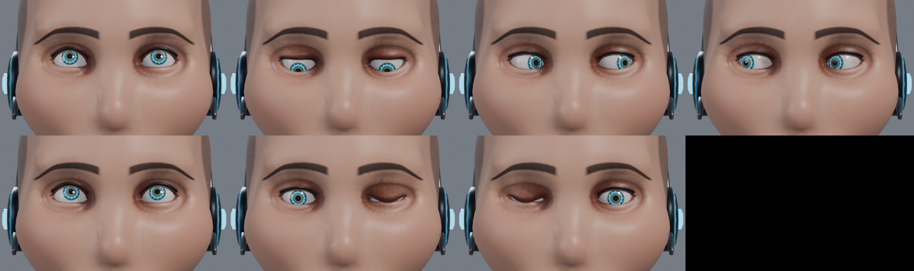

## 5. Spoken performance (`dialogue`, 16.6 s)

> Operative to all teams. The relay is failing, and the lane is wide open. Hold your positions. Give me thirty
> seconds. I'll stabilize the network myself. There. Signal is back. Push forward, and thank you for trusting me.

* Audio: local speech synthesis (Piper TTS, voice `en_US-ljspeech-high`), 15.7 s, 48 kHz mono.
* `dialogue_alignment.json`: 38 words and 152 phonemes with start/end times taken from the synthesiser's own
  duration output (not estimated), the IPA-to-viseme table, segment emotions and the three markers.
* The clip keys the 13 viseme controls per frame from that alignment (anticipation and release per phoneme, lip
  closures guaranteed a full frame, stress-scaled vowels) and layers authored acting on top: comms call into the
  forearm console, pointing at the failing relay, open arms on "wide open", palm-out stop gesture, fore-arm
  typing with the eyes on the console, then the emotional shift on "There." (tension to relief and a smile),
  a forward point and a hand on the chest. Gaze changes are 3-frame saccades; blinks sit on gaze changes.
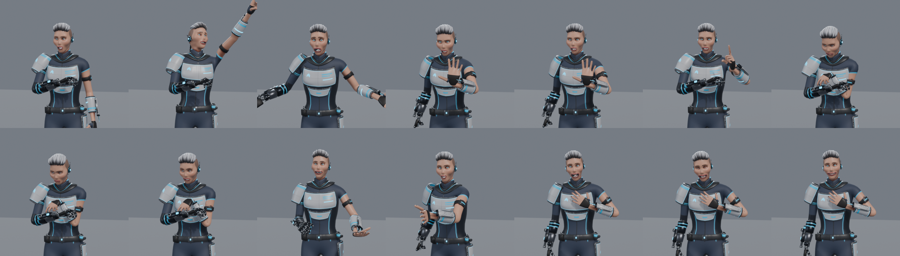 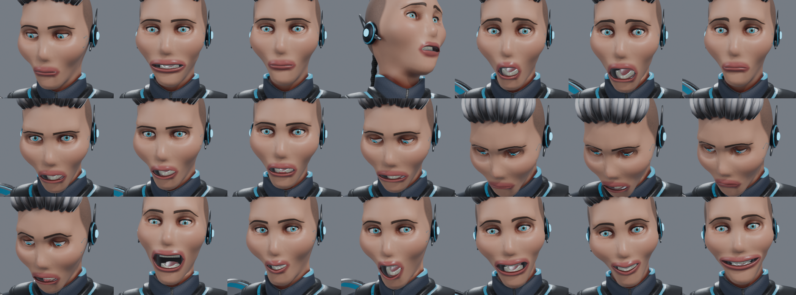

## 6. Animation inventory

96 entries (85 motions, 11 poses) exactly as in `required_animations.csv`, 30 fps, each one an editable action
on the control rig, a baked action on the skeleton, an FBX and an Unreal `AnimSequence`
(`/Game/Operative/Animations/<id>`). `docs/animation_manifest.json` lists per entry: source and baked action,
file/take, Unreal path, frame range, duration, loop flag, root-motion policy and displacement, layer, entry/exit
states, event markers, nominal speed and travel direction, speed profiles (start/stop/pivot), prop tracks,
floor-contact flag and QA numbers measured on the baked skeleton.

* Locomotion: eight directional walks and runs relative to the facing (150 / 400 cm/s), sprint (650 cm/s),
  phase-synchronised (left contact at 0, right at 0.5); planted feet move exactly with the ground speed.
* Dashes carry 200 cm of root motion; blinks carry none (teleport is an event).
* Reload, deploy and the ground cast use measured hand / prop / floor contacts; the dead poses are the last frame
  of their death clips.
* The cable is simulated for every clip and stored as keys on its controls.
* Event markers are stored as pose markers on the source actions, so they can be moved in Blender and are picked
  up by the re-bake (`tools/export_and_bake.py -- --from-blend`).

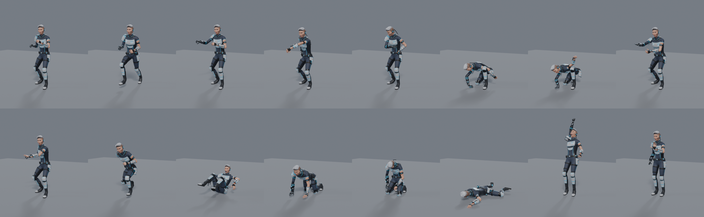

### What was verified on the Blender side

* The build asserts the triangle budgets, at most 8 influences, at most 8 material slots, the mesh hygiene listed
  above, clip durations against `required_animations.csv` and that every driver is a simple expression.
* QA numbers per clip (manifest `qa`): every loop closes exactly (loop error 0 on all joint channels), planted
  feet follow the ground speed (0 cm/s slide on 16 of the 17 gait cycles, see `docs/known_issues.md` for
  `walk_f`), lowest sole point -0.4 cm, no torso, head, arm, hand, calf or foot joint closer to the floor than its
  approximate body radius in any clip (lowest clearance +0.2 cm), both dead poses identical to the last frame of
  their death clips on every channel (including the cable).
* Rig UI operators run from the saved file: IK/FK snapping changes the pose by less than 0.1 mm / 0.1 degrees
  on the arms; on the legs the joint positions are kept exactly, the foot within 0.1 degrees and the toe joint
  within 0.7 degrees (foot roll is folded into the control). Global scale 0.5x / 2x scales the posed mesh
  exactly, reset returns to the rest pose (deviation below 1e-6 m), the cable bake reproduces the stored keys.
* Re-bake path: moving an event marker and re-running `--from-blend` updates the manifest and the clip FBX.
* The .blend opens in Blender 5.1.1 with relative texture paths only, no linked libraries and no add-ons.
* Renders in `docs/images/` are made from the delivered .blend by `tools/render_evidence.py`.

## 7. Unreal showcase

Native C++ animation controller (no Animation Blueprint) implementing `docs/animation_state_contract.md`:
eight-direction gait blending with independent facing, upper-body action layer, aim grid, additive hits,
priorities and interrupts for channel / charge / uplink / reload / disables / death / respawn, exactly-once
event dispatch, action rate 0.5x-1.5x, ground adaptation on the 20 degree ramp and the 20 cm steps, runtime
helper bones, cable simulation, face control layer. Room: floor, ramp, steps, movable aim targets, prop station,
motion viewer.

### Controls (also in the application: F1 overlay and the Help tab; full reference `docs/showcase_controls.md`)

| Group | Input | Action |
|---|---|---|
| Move | `W A S D` | move relative to the camera (eight directions) |
| | `Left Shift` / `Left Ctrl` | sprint / walk |
| | `M` | strafe-aim mode (facing follows the aim point) or travel mode (uses `start_f`, `stop_f`, `pivot_*`) |
| Aim | mouse, wheel | aim point on the floor, aim height (pitch) |
| | `RMB` (hold), `Tab` | raise the emitter arm; lock / release the aim on a target |
| | `LMB` on a target | drag the target |
| Act | `LMB`, `B`, `R` | shot, three-shot burst, reload |
| | `F` | melee; again inside the combo window for `melee_2`, `melee_3` |
| | `Space`, `Q`, `E` | jump, dash (in the held direction), blink to the cursor |
| Cast | `1` `2` `3` | directional / ground / self cast |
| | `C` (hold), `G` (hold) | channel, charge (release = finish / fire) |
| | `X` | **interrupt** channel / cancel charge / cancel uplink |
| | `T` / `U` | deploy the beacon / uplink |
| Hits | `7` `8` `9` `0` | additive hit from front / left / back / right |
| | `4` `5` `6` `-` | stun / sleep / knock-back / knock-up |
| | `[` `]` | knock-down to the back / to the front (then get-up) |
| Life | `K` / `L`, `P` | death from the front / back, respawn |
| | `Backspace` | reset the character |
| | `I` | wounded presentation |
| Emote | `Z` `V` `N` | greet / victory / defeat |
| | `Enter` | speech sample (`dialogue` with audio and subtitles, in the head-and-shoulders view) |
| View | `Home` `End` | top-down gameplay view (55 degrees) / third-person close |
| | `PgUp` `PgDn` | full-body front / side |
| | `Insert` `H` | face close-up / head and shoulders (lips and hand gestures) |
| | `Delete` | free orbit (`RMB` drag, wheel zoom) |
| | `F9` | cycle the views |
| Show | `F1` `F2` `F3` | help, panel (Help / Animations browser with search / Face / Character / States), data HUD |
| | `F4` | skeleton overlay |
| | `F5` `F6` `F10` | team A/B, outline, ground ring |
| | `F7` `F8` | LOD auto/0/1/2; textured / wireframe / normals / clay |
| | `O` | one or ten Operatives |
| | `,` `.` | action rate down / up (0.5x - 1.5x) |
| | `F11` | deterministic showcase sequence |
| Console | `~` | `mr <command>` (every key and button is a command) |

### What was verified on the packaged client

`tools/ue_full_cycle.sh verify` runs the client offscreen with a fixed 30 fps step and checks three traces with
`tools/verify_trace.py` (reports in `docs/verification/`):

* **Deterministic sequence** (19 chapters, about 200 s): all 96 entries exercised, 22 of 22 combined-state
  expectations met (shot / burst / cast while running, reload while walking and cancelled, charge at two levels
  and cancelled, channel interrupted midway and completed, uplink cancelled and completed, hits while running,
  both knock-downs and get-ups, death during a cast and during a jump with the second death refused, dashes,
  pivots, turns), no event rule violated (once per pass, nothing after an interruption, ordered, muzzle counts).
* **Injected-input self-test** (real Slate mouse / keyboard events): panel, search box, list selection, aim and
  fire while moving, channel interrupt, reset, speech sample.
* **Motion viewer pass**: all 96 entries selected and started.
* Import report: 84 bones with reference pose error below 0.001 cm, mesh 0 to 180.8 cm, 32 morph targets with
  data on all three LODs, 96 sequences, notifies from the manifest, 22 textures, no problems.

### Frame time (reference host, 1920x1080, no upscaling, no frame generation)

`tools/run_benchmark.sh` starts the packaged client offscreen at 1920x1080, warms up for 10 s and samples 20 s of
frames while the controlled Operative runs, aims, fires, bursts, casts, jumps, uses melee and dashes (in the
ten-instance run nine more do the same on autopilot). Top-down gameplay camera, LOD selection automatic,
TAA at 100 % screen percentage, virtual shadow maps on, Lumen global illumination off, no vertical sync, no frame
limit, no upscaling and no generated frames. Development build.

| | 1 Operative | 10 Operatives |
|---|---|---|
| Frames sampled | 9854 | 7771 |
| Average frame time | 2.03 ms (493 fps) | 2.57 ms (389 fps) |
| Median | 1.82 ms | 2.26 ms |
| 95th percentile | 3.36 ms | 4.48 ms |
| 99th percentile | 5.01 ms | 6.44 ms |
| Slowest frame | 13.1 ms | 15.8 ms |
| Game thread / render thread / GPU (average) | 0.83 / 1.70 / 1.54 ms | 1.46 / 2.30 / 1.63 ms |
| Frames slower than 16.67 ms (60 fps) | 0 of 9854 | 0 of 7771 |

The 60 fps target (16.67 ms per frame) is met with a wide margin: the 99th percentile is 5.0 ms with one and
6.4 ms with ten Operatives.
Host: AMD Ryzen 9 9950X 16-Core Processor (16 cores / 32 threads), 92 GB RAM, NVIDIA GeForce RTX 5090 (driver 595.71), Vulkan, Linux 6.18.59.
Host load when the run started: load average 30.51 on 32 threads, CPU 23 % (idle 77 %, iowait 0 %); GPU 0 %, 5298 MiB.
The host is shared: other workloads were using about a quarter of the CPU when this run started (recorded above),
which lengthens the game-thread and render-thread times and varies from minute to minute. A run started a few
minutes earlier was discarded because another job took 89 % of the CPU and 19 GB of GPU memory while it was
sampling (it measured 90 fps on average); see `docs/known_issues.md`.
Logs: `docs/benchmark/one_operative.json`, `ten_operatives.json` (statistics, settings, system), `*_frames.csv` (every
frame time of the sample), `host.txt`, `benchmark_trace.log`.

## 8. Authorship and third-party content

* Geometry, UVs, textures, materials, skeleton, weights, shape keys, rig, all 96 animation entries, the Unreal
  C++ code and the showcase room were made for this assignment. No store or stock character, body, head,
  MetaHuman, pre-skinned model, motion capture or animation library was used, and no other generative model or
  service produced any of it.
* The spoken line was synthesised locally with Piper TTS (listed as the permitted speech synthesis in
  `environment.json`) and a voice trained on the public-domain LJ Speech corpus; see
  `docs/THIRD_PARTY_ASSETS.csv` for source, licence, hashes and redistribution notes. The transcript, the
  segmentation, the pacing and the performance are original.
* The packaged client contains the Unreal Engine runtime and engine basic shapes / default fonts under the
  Unreal Engine EULA.

## 9. Limits of what was tested

See `docs/known_issues.md`. The most important one: this was produced and verified on a headless host - the
packaged client was only run with `-RenderOffScreen` (frames, traces and videos were inspected), never in a
presented window with a physical keyboard, mouse and speakers.

The sibling folder `../_scratch` holds development scripts, build logs, review images and the downloaded
speech-synthesis voice. It is not part of the delivery and nothing in `MorphRig/` depends on it.
